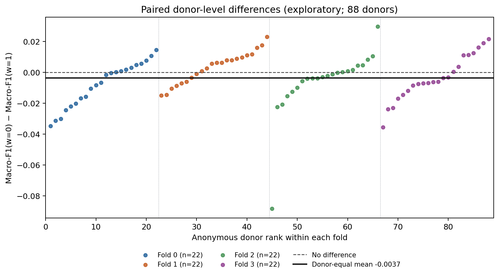

# Compact gene panels and donor generalization in single-cell transcriptomics

**Independent Exploratory Research in Computational Biology**

This repository documents an independent exploratory research project investigating how patient-identity supervision influences compact gene-panel selection and donor-held-out classification in single-cell transcriptomics. It includes the research report, selected analysis code, descriptive results, and methodological limitations. The study has not undergone peer review and does not provide confirmatory evidence.

This public-ready repository accompanies a four-page, descriptive exploratory research report.

**Research author:** Paola Aguirre · **Code:** MIT · **Report, figures and results:** CC BY 4.0

## Scientific question

When a sparse multi-task model selects a compact 64-gene panel to recognise immune-cell classes,
does also asking it to recognise *which individual* each cell came from (identity supervision, w = 1)
change the selected genes — and does the panel then transfer worse to individuals never seen in
training than a panel selected for cell class alone (w = 0)?

## Ongoing research direction

Building on the initial exploratory study, the next phase investigates how auxiliary donor-identity supervision changes gene selection in single-cell transcriptomics.

The focus is on characterizing which genes are gained or lost, assessing the reproducibility of these changes across donor-disjoint training sets, and exploring their potential biological and technical interpretations.

The follow-up experimental protocol remains under review. No prospective results are reported.

## Approach

* Processed peripheral-blood scRNA-seq subset derived from Stephenson et al. (2021); sample labels
  mapped to biological individuals; eligible individuals with enough cells in at least three of five
  lymphocyte/NK classes.
* One site-stratified, donor-disjoint four-fold partition; training-only within-fold withholding,
  highly variable genes and standardization.
* `MultiTaskLasso` panels of 64 genes per fold and arm; multinomial logistic-regression classifiers.
* Primary descriptive quantity: donor-equal mean paired macro-F1 difference Δ = F1(w=0) − F1(w=1)
  over held-out individuals.
* Exploratory controls: expression-matched random 64-gene panels (20 per fold) and numerical
  sensitivity checks (fixed-alpha tolerance refits, identity-permutation sanity check, fallback diagnosis).

Details: [`docs/METHODS.md`](docs/METHODS.md) · [regenerated Markdown report](report/compact_gene_panels_report_v2.0.md) · [updated four-page PDF (v2.0)](report/exploratory_report_v2.0.pdf)

## Results

<!-- RESULTS:START -->
*Generated by `cgp rebuild-results` from `results/results.json`; descriptive, one cross-validation repetition.*

| Quantity | Value |
|---|---|
| Held-out individuals (all folds) | 88 |
| Mean macro-F1, w=0 (cell class) | 0.907442 |
| Mean macro-F1, w=1 (cell class + identity) | 0.911095 |
| Mean macro-F1, expression-matched random panels | 0.783828 |
| Donor-equal mean paired Δ = F1(w=0) − F1(w=1) | −0.0036525 |
| Individuals with Δ > 0 / < 0 / = 0 | 39 / 49 / 0 |
| Within-fold panel Jaccard(w=0, w=1) | 0.506–0.600 |

A negative Δ means w=1 scored slightly higher; it does not indicate benefit, equivalence or non-inferiority. Identity supervision changed many selected genes with little change in held-out performance.



**Reproduction (Level A) against the historical records:** overall `EXACT` — 54 components bit-identical, 0 within tolerance, 0 discrepancies (fold plans: 4 EXACT; preprocessing: 4 EXACT; alpha searches and panels: 8 EXACT; classifiers: 8 EXACT; random-reference panels and models: 4 EXACT; held-out scores (main arms): 4 EXACT; held-out scores (random reference): 4 EXACT; stability checks: 10 EXACT; results package (tables, summary values, figures): 8 EXACT.)
<!-- RESULTS:END -->

## Repository layout

| Path | Content |
|---|---|
| `src/compact_panels/` | Package: data access, identity mapping, partitions, preprocessing, panel selection, classifiers, evaluation, random reference, stability checks, comparison, reporting, CLI |
| `configs/` | `study.toml` (all scientific parameters), `synthetic.toml`, `inputs.toml` (input provenance), `acceptance.toml` (comparison tolerances), `historical_references.toml` (SHA-256 pins of the historical artifacts, directory aliases only), `historical_dirs.example.toml`, `paths.example.toml` |
| `tests/` | Synthetic test-suite (no real data) and an optional historical-trace conformance test |
| `results/`, `figures/` | Tables, figures, `results.json`, comparison with the historical reference, SHA-256 manifest; individual codes in `table_01` are linkable pseudonyms (see [`docs/DATA.md`](docs/DATA.md)) |
| `report/` | Regenerated Markdown report and template; updated four-page research PDF (`exploratory_report_v2.0.pdf`) |
| `docs/` | Methods and limitations, data provenance and access, reproducibility guide, historical fidelity |
| `ledger/` | Execution ledger of the reproduction |

## Quick start (no real data needed)

```bash
python3.13 -m venv .venv && source .venv/bin/activate
pip install -e .
(cd tests && python -m unittest -v)
cgp synthetic-demo --out /tmp/cgp-demo
```

## Full reproduction with the real data

Requires the processed H5AD (SHA-256 `2345f3c5…ab738e`; distributed as a public pertpy example dataset
whose SHA-256 and size were confirmed identical to the verified file by a streamed download on 2026-11-16) and the public
ArrayExpress E-MTAB-10026 SDRF; see [`docs/DATA.md`](docs/DATA.md) and
[`docs/REPRODUCIBILITY.md`](docs/REPRODUCIBILITY.md) for commands, runtime, memory, checkpoint recovery
and comparison with the reference results.

```bash
cgp derive-inputs --h5ad H5AD --sdrf SDRF --out data/
cgp validate --deep
cgp reproduce --through train
cgp score --confirm-held-out-access
cgp stability g3 && cgp stability g4 && cgp stability h1
cgp rebuild-results
```

## Reproducibility status

* **Level A — verified-input reproduction:** see the status block above and
  `results/comparison_with_historical_reference.json`.
* **Level B — source-data reconstruction:** not claimed (the subsampling that produced the processed
  H5AD is not published as code).

## Citation and licences

Cite via [`CITATION.cff`](CITATION.cff). Code: [MIT](LICENSE). Report, figures, tables and documentation
prose: [CC BY 4.0](LICENSE-CONTENT.md). No third-party expression data are redistributed.

## AI assistance

AI tools assisted with the project and manuscript preparation. Claude conducted separate computational audits, and ChatGPT assisted with manuscript review. The author retains responsibility for the scientific content and conclusions.
