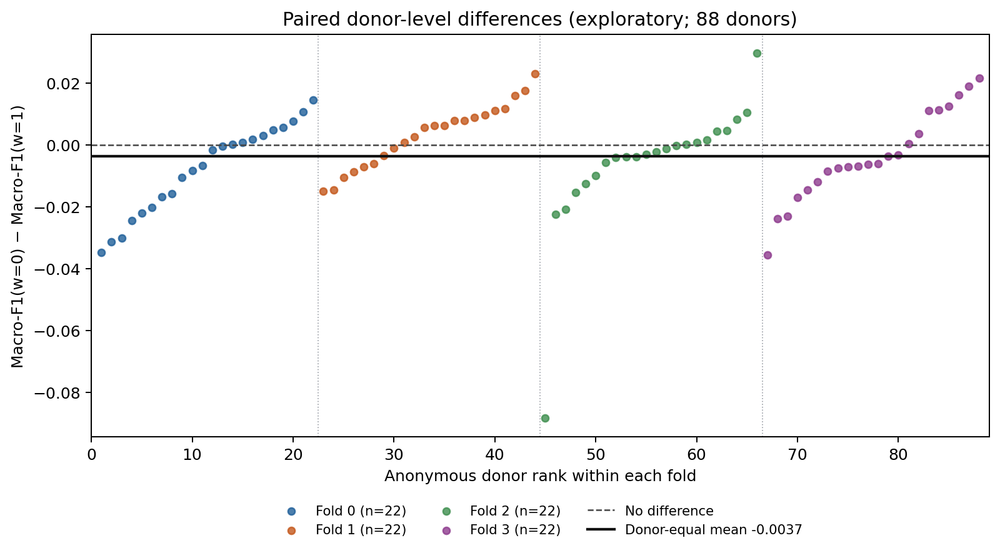
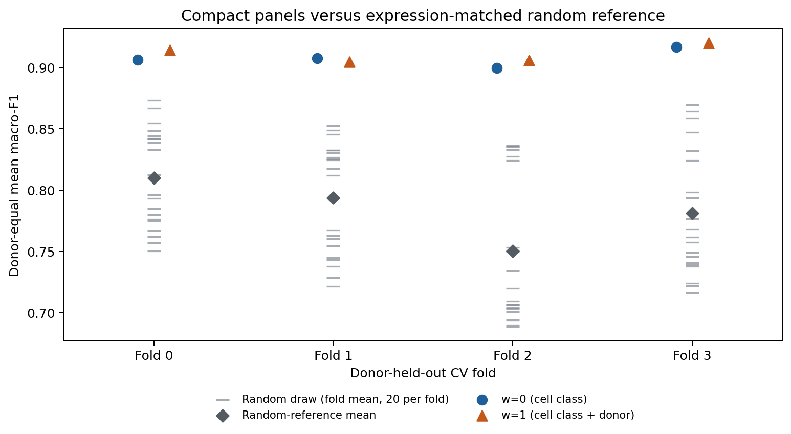
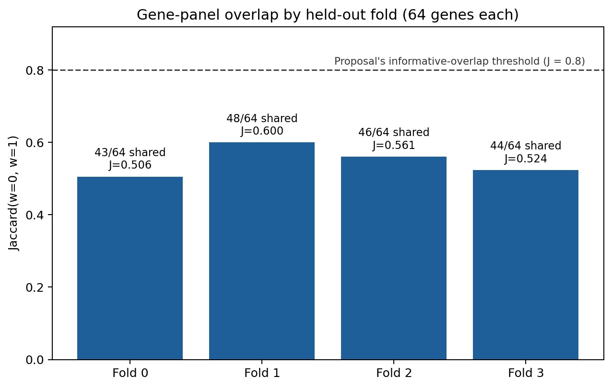

# Patient-Identity Supervision in Compact Gene Panel Selection: An Exploratory Analysis of Generalization to Unseen Donors in scRNA-seq

**Paola Aguirre** · Research report v2.0 (regenerated from the reproduced computation) · {{build_date}}

*Every number in this report is inserted programmatically from `results/results.json`
(SHA-256 `{{results_sha}}`) by `cgp rebuild-results`; none is typed by hand. The historical computation (report v1.3) with which this reproduction
was compared is kept unchanged; its artifacts are not distributed and are identified by SHA-256 in
`configs/historical_references.toml`.*

## Abstract

**Question.** Does adding biological-individual identity as an auxiliary supervision target alter
compact gene selection and the classification of immune-cell subtypes in previously unseen
individuals? **Methods.** An eligible subset of the Stephenson et al. single-cell peripheral-blood
dataset was analysed after mapping sample labels to biological individuals. {{n_panels_cap}} {{k}}-gene panels were
selected by multi-task sparse regression across one donor-disjoint {{n_folds}}-fold partition
({{n_individuals}} individuals; {{n_cells}} eligible cells): with cell-class labels alone (w=0) or with
class labels plus identity (w=1). L2-regularized classifiers predicted {{n_classes}} lymphocyte/NK-cell classes.
The descriptive primary quantity was the donor-equal mean of paired macro-F1 differences,
F1(w=0) − F1(w=1). **Results.** The mean paired Δ was **{{delta_4}}** ({{pos}} positive and {{neg}}
negative individual-level differences); fold means ranged from {{fold_delta_min}} to {{fold_delta_max}}.
A negative Δ indicates slightly higher observed macro-F1 for w=1; it does not indicate benefit,
equivalence or non-inferiority. Panel Jaccard similarity ranged from {{jac_min}} to {{jac_max}}.
Cell-class-only panels exceeded the mean of {{n_draws}} expression-matched random {{k}}-gene panels per
fold by **{{w0_minus_random_3}}** macro-F1. {{g3_sentence}} **Reproduction.** The complete pipeline —
cohort, folds, preprocessing, all {{n_panels}} alpha searches, {{n_classifiers}} classifiers, {{n_random_models}} random-reference
models, held-out scoring and the exploratory numerical checks — was re-executed from the hash-verified input;
{{repro_sentence}} **Interpretation.** Auxiliary identity supervision substantially changed the selected
genes without an observed average loss on this partition and task. This is not a confirmatory test, and
identity may proxy library, site, disease state, sex or cell composition.

## 1. Question

Compact transcriptomic panels can distinguish cell states while remaining interpretable and
inexpensive. Adding donor identity as a second supervised target might favour genes carrying
individual-specific information, displacing cell-type markers and impairing transfer to unseen
individuals; it might also be neutral or beneficial. The exploratory question addressed here is: *how
different are {{k}}-gene panels selected with and without identity supervision, and how do their fixed
downstream classifiers perform on donor-held-out cell-type classification in one {{n_folds}}-fold partition?*

## 2. Data and methods

A processed, subsampled object derived from Stephenson et al. (2021) [1] ({{dataset_cells}} cells, {{dataset_genes}} genes)
was analysed. Sample labels were mapped to published individuals; LPS-stimulated cells and one
QC-excluded collection were removed; individuals with at least {{min_cells}} cells in at least {{min_classes_word}} of {{n_classes}}
classes ({{class_list}}) were eligible: **{{n_individuals}} individuals and
{{n_cells}} cells**. {{n_folds_cap}} site-stratified donor-disjoint folds held out {{per_fold_individuals}} individuals each. Within the
training individuals of each fold, about one fifth of cells were withheld; {{n_hvg}} highly variable genes (Scanpy,
seurat flavour [2, 3]) and standardization were estimated on the remaining fitting cells only.
`MultiTaskLasso` [4, 5] selected {{k}} genes per arm through a per-fold alpha search (fallback: {{k}} largest
coefficient-row norms); fold 0 followed a different alpha sequence from folds 1–3 towards the same
target. Multinomial L2 logistic regression was trained on each panel. Macro-F1 was computed per
held-out individual over classes with at least {{min_cells}} true cells, counting every test cell for false
positives. Exploratory controls: a random reference ({{n_draws}} expression-bin-matched {{k}}-gene panels
per fold), fixed-alpha tighter-tolerance refits (G3), an identity-permutation sanity check (G4) and a
fallback diagnosis (H1). Full details: `docs/METHODS.md`.

## 3. Results

### 3.1 Donor-held-out performance

**Table 1. Donor-equal mean macro-F1 by held-out fold.**

| Fold | Individuals | Macro-F1 w=0 | Macro-F1 w=1 | Random-reference mean | Paired Δ (w=0 − w=1) |
|---|---:|---:|---:|---:|---:|
{{table_rows}}
| **All folds** | **{{n_individuals}}** | **{{w0_4}}** | **{{w1_4}}** | **{{random_4}}** | **{{delta_4}}** |

*Rounded to four decimals from unrounded individual-level values; Δ is computed before rounding.
Unrounded global values: w=0 {{w0_6}}, w=1 {{w1_6}}, random {{random_6}}, Δ {{delta_7}}.*

Of {{n_individuals}} paired differences, {{pos}} were positive, {{neg}} negative and {{zero}} zero; the
median was {{median_4}}. A negative Δ indicates slightly higher observed macro-F1 for w=1 on this task
and partition; it does not demonstrate benefit, equivalence, non-inferiority or absence of harm.

### 3.2 Random reference and panel composition

Cell-class-only panels exceeded the random reference by {{w0_minus_random_3}} macro-F1 (w=1:
{{w1_minus_random_3}}); w=0 exceeded every random draw on the fold means: {{beats_fold_means}}. At the
individual level, w=0 exceeded every corresponding random draw for {{beats_all}} of {{n_individuals}}
individuals. These comparisons show that the selected panels outperform this particular reference, not
that they are optimal.

Within each fold, the w=0 and w=1 panels shared {{shared_min}}–{{shared_max}} of {{k}} genes (Jaccard
{{jac_min}}–{{jac_max}}, mean {{jac_mean}}). {{fallback_sentence}}

### 3.3 Exploratory numerical checks

*{{exploratory_label}}*

{{g3_detail}} {{g4_sentence}} {{h1_sentence}}

## 4. Reproducibility

**Level A (verified-input reproduction).** Starting from the processed H5AD (SHA-256 pinned) and two
auxiliary inputs that are re-derivable from public sources, the pipeline re-executed every stage. Each
component was compared with the historical records under tolerances fixed before the comparison
(`configs/acceptance.toml`): {{repro_detail}}

**Level B (source-data reconstruction)** is not claimed: the subsampling and preprocessing that
produced the processed H5AD are not published as code.

## 5. Interpretation and limitations

The principal descriptive observation is a large change in selected gene identity with little change
in unseen-donor classification performance. One explanation is that this five-class task admits several
predictive feature sets; another is that library- and disease-related signatures enter the
identity-supervised objective. Neither is established by these data. Limitations: one cross-validation
repetition; fold 0 was evaluated before the runner for folds 1–3 existed; a path-dependent alpha search
with one fallback panel; dependence on published annotations derived with the held-out cells; unknown
subsampling provenance; confounding of identity with library, site, disease state, sex and composition;
retrospective random controls; no stronger baselines, decoy task, displacement control or fresh-seed
repetitions. These rule out confirmatory claims of harm, benefit or equivalence and causal attribution
to identity.

## 6. Conclusion

In one exploratory donor-disjoint {{n_folds}}-fold evaluation of {{n_individuals}} individuals, auxiliary
identity supervision changed {{changed_min}}–{{changed_max}} of the {{k}} genes in each panel, while the mean paired
individual-level macro-F1 difference was {{delta_4}}. Both arms clearly exceeded an expression-matched
random reference. The full computation is reproducible from the verified input with the code in this
repository.

## AI declaration

AI tools assisted with the project and manuscript preparation. Claude conducted separate computational audits, and ChatGPT assisted with manuscript review. The author retains responsibility for the scientific content and conclusions.

## References

1. Stephenson E, Reynolds G, Botting RA, et al. Single-cell multi-omics analysis of the immune response in COVID-19. *Nature Medicine* 27, 904–916 (2021). doi:10.1038/s41591-021-01329-2
2. Wolf FA, Angerer P, Theis FJ. SCANPY: large-scale single-cell gene expression data analysis. *Genome Biology* 19, 15 (2018). doi:10.1186/s13059-017-1382-0
3. Satija R, Farrell JA, Gennert D, Schier AF, Regev A. Spatial reconstruction of single-cell gene expression data. *Nature Biotechnology* 33, 495–502 (2015). doi:10.1038/nbt.3192
4. Pedregosa F, Varoquaux G, Gramfort A, et al. Scikit-learn: Machine Learning in Python. *Journal of Machine Learning Research* 12, 2825–2830 (2011).
5. Obozinski G, Taskar B, Jordan MI. Joint covariate selection and joint subspace selection for multiple classification problems. *Statistics and Computing* 20, 231–252 (2010). doi:10.1007/s11222-008-9111-x
